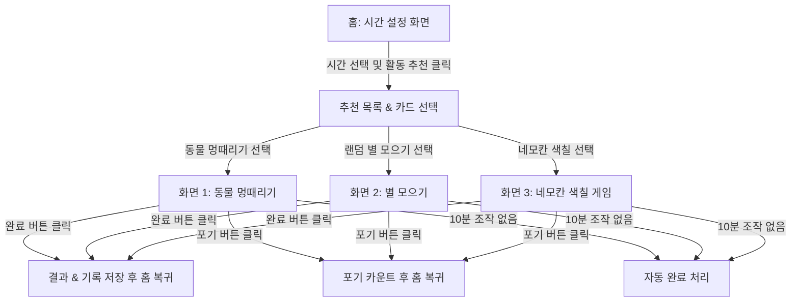

# [앱 계획서] 쉬는타임 (BreakTime)
> **"짧은 공강 시간도 의미 있고 편안하게"**  
> 대학생 공강 맞춤형 미니 힐링 & 인터랙티브 웹앱

---

## 1. 프로젝트 개요

| 항목 | 내용 |
| :--- | :--- |
| **앱 이름** | **쉬는타임 (BreakTime)** |
| **기획자** | 황수인 (나눔의 교육 4조 / 20241696) |
| **한 줄 소개** | 공강 시간을 지루하게 보내는 학생의 "무엇을 해야 할지"에 대한 부담을 덜어주는 맞춤형 쉼터 앱 |
| **핵심 HMW** | 어떻게 하면 우리가 짧은 공강 시간이더라도 지루하지 않게 보낼 수 있도록 도울 수 있을까? |
| **기술 형태** | 별도 설치나 빌드 과정 없이 더블클릭으로 바로 실행되는 단립형 모바일 최적화 웹앱 (`index.html`) |
| **데이터 저장** | 브라우저 `localStorage` (로그인 불필요, 개인정보 수집 없음) |

---

## 2. 사용자 분석 및 디자인 원칙

### 2.1 타겟 사용자 (페르소나)
- **대상**: 공강 시간을 지루하게 보내는 대학생 (특히 3학년 등 강의 간 틈새 시간이 애매한 학생)
- **이용 상황**: 강의실이나 교내 휴게 공간에서 밥을 먹거나 큰 활동을 하기엔 시간이 애매해 멍하니 시간만 보내는 상태
- **사용 환경**: 조용한 강의실, 도서관, 라운지 등 (무음 권장 환경)

### 2.2 디자인 & UX 원칙
1. **눈의 피로감 최소화 & 모던 미니멀 UI**:
   - 깔끔한 화이트/소프트 그레이 기반의 카드 레이아웃
   - 눈부심 없는 부드러운 대비감과 미려한 폰트/아이콘
2. **모바일 퍼스트 (Mobile-First Frame)**:
   - PC 브라우저에서도 스마트폰 비율(최대 430px 너비)로 가운데 정렬되어 실제 앱을 쓰는 듯한 몰입감 제공
3. **무음(Sound-Free) & 시각적 피드백**:
   - 소리 없이도 터치/클릭에 기분 좋은 시각적 인터랙션(바운스, 페이드, 입자 효과) 제공
4. **극도의 단순한 조작**:
   - 복잡한 튜토리얼 없이 직관적인 버튼 1~2개로 모든 활동 제어

---

## 3. 핵심 기능 명세

### 3.1 남은 공강 시간 설정 (최대 240분 확장)
- **기능**: 식사 및 강의실 이동 시간을 뺀 실제 자유 공강 시간을 최소 5분부터 **최대 240분(4시간 대형 공강)**까지 간편하게 설정
- **입력 방식**:
  - 빠른 선택 프리셋 버튼: `5분`, `10분`, `15분`, `20분`, `30분`, `45분`, `60분`, `90분`, `120분 (2시간)`, `180분 (3시간)`, `240분 (4시간)`
  - 직접 슬라이더: `5분 ~ 240분` (5분 단위 미세 조절 가능, 60분 이상 시 '시간+분' 단위 직관적 병기)
- **실행**: 시간 입력 즉시 해당 시간대에 최적화된 활동 추천 실시간 반영

### 3.2 맞춤 활동 추천 & 정렬 알고리즘 (추천 최우선 & 포기 페널티 반영)
- **1순위 (절대 최우선)**: **현재 공강 시간대에 추천하는 활동 목록은 무조건 비추천 목록보다 최상단에 배치**
  - 5~10분 추천: 뽁뽁이 터뜨리기, 별 모으기, 동물 멍때리기
  - 10~20분 추천: 걱정 분쇄기, 감성 모래시계, 동물 멍때리기, 별 모으기
  - 20~30분 추천: 카드 짝맞추기, 네모칸 색칠 게임, 감성 모래시계
  - 30분 이상 추천: 공강 화분 키우기, 네모칸 색칠 게임, 카드 짝맞추기
- **2순위**: **포기 횟수(giveup_count)가 많을수록 하단에 배치**
  - 추천 목록 내에서도 포기가 10회 등 많다면, **추천 목록 블록 안에서 하단에 배치** (전체 목록의 하단으로 떨어지지 않고 추천 그룹 내에서만 하단으로 정렬)
- **3순위**: 포기 횟수가 동일한 경우, **완료 횟수(use_count)가 많은 활동일수록 상단에 배치**

---

## 4. 킬링 미니 콘텐츠 상세 설계

### [기존 핵심 3종 - 대규모 디테일 강화]
#### ① 동물 멍때리기 (5~15분 추천)
- **컨셉**: 평화로운 잔디 들판에 귀여운 동물들이 노니는 것을 지켜보는 힐링 스크린
- **상세 강화**:
  - **최대 10마리 동시 등장**: 화면 내 최대 10마리의 동물이 각자 자유롭게 산책, 식빵굽기, 낮잠 모션 수행
  - **10종 모두 서로 다른 품종 분화**:
    - 강아지 5종: 시바견(황구), 웰시코기, 토이푸들, 달마시안(점박이), 비숑 프리제
    - 고양이 5종: 치즈 태비, 고등어 태비, 삼색이, 턱시도, 샴/러시안 블루
  - 개별 동물 터치 시 고유 이모지(`💖`, `🐾`, `✨`, `💤`, `🌸`) 및 호흡 가이드 연동

#### ② 랜덤 별 모으기 (5~15분 추천)
- **컨셉**: 멍때리면서 화면 곳곳에 떨어지거나 반짝이는 별을 터치하여 수집하는 힐링 클리커
- **상세 강화**:
  - **10가지 색상별 별**: 레몬 옐로우(+1), 애프리콧 오렌지(+1), 루비 레드(+2), 체리 핑크(+2), 라벤더 바이올렛(+3), 스카이 블루(+3), 사파이어 딥블루(+4), 에메랄드 민트(+4), 크리스탈 화이트(+5), 무지개 레인보우(+10)
  - **화면 내 최대 10개 동시 출현**: 넉넉하고 빠른 템포로 별을 터치하여 수집하는 시각적 쾌감
  - 수집한 별로 별 테마 샵에서 앱 테마 색상 해금

#### ③ 네모칸 색칠 게임 (20분 이상 추천)
- **컨셉**: 격자(Grid) 캔버스에 감각적인 팔레트 색상으로 칸을 채워 작은 픽셀 아트를 완성하는 힐링 컬러링
- **상세 강화**:
  - **최소 7종 도안 라인업**:
    1. [8x8] 빨간 하트
    2. [8x8] 행운 네잎클로버
    3. [10x10] 고양이 발바닥
    4. [10x10] 달콤한 사과
    5. [10x10] 반짝이는 픽셀 별
    6. [12x12] 아기 곰돌이
    7. [12x12] 파스텔 무지개
  - **다양한 격자 크기 지원**: 도안 및 자유 모드에서 8x8, 10x10, 12x12, 16x16 가변 캔버스 렌더링 지원
  - 모바일 터치 드래그 및 마우스 드래그 색칠 완벽 지원

---

### [신규 추가 추천 5종 라인업]
#### ④ 🫧 뽁뽁이 터뜨리기 (5~10분 초단기 추천)
- **컨셉**: 빈 강의실에서 아무 생각 없이 뽁뽁이를 터뜨리며 즉각적인 쾌감과 스트레스를 날리는 피젯 토이
- **주요 기능**: 
  - **전체 완파 리필 룰**: 30개 버블을 모두 터뜨려야 새 뽁뽁이로 교체 (미완료 시 남은 개수 안내)
  - 30개 완파 시 자동으로 축하 효과와 함께 새 시트 리필
  - **황금 뽁뽁이(보너스 별 +5) 및 무지개 뽁뽁이(대박 보너스 별 +15)** 획득 시스템

#### ⑤ 🗑️ 걱정 분쇄기 (10~15분 단기 추천)
- **컨셉**: 과제, 학점, 인간관계 고민을 메모지에 간단히 적고 파쇄기로 갈아버리는 감정 디톡스
- **주요 기능**: 3줄 고민 메모 작성 후 파쇄 버튼을 누르면 종이가 가루로 갈려 사라지는 카타르시스 효과

#### ⑥ ⏳ 감성 모래시계 & 명상 (10~20분 단기 추천)
- **컨셉**: 눈의 피로를 풀며 폰을 내려두고 멍때리거나 짧은 쪽잠을 청할 수 있는 마인드풀니스
- **주요 기능**: 스르륵 떨어지는 모래 입자 애니메이션, 편안한 힐링 문구 표시, 완료 시 부드러운 화면 전환

#### ⑦ 🧩 카드 짝맞추기 (15~30분 중기 추천)
- **컨셉**: 가볍게 두뇌를 깨우고 지루함을 달래는 캐주얼 메모리 게임
- **주요 기능**: 32종 풍성한 이모지 풀을 기반으로 **16장(4x4, 8쌍), 24장(4x6, 12쌍), 32장(4x8, 16쌍), 64장(8x8, 32쌍 마스터)** 난이도 자유 선택 지원

#### ⑧ 🪴 나만의 공강 화분 키우기 (30~60분 중·장기 추천)
- **컨셉**: 공강 시간에 자습이나 과제, 독서를 할 때 함께 자라나는 나만의 반려 식물
- **주요 기능**:
  - **15단계 대확장 성장 트리**: 1단계(흙 속 씨앗)부터 10단계(첫 꽃 개화)를 지나 15단계(전설의 황금 생명수)까지 섬세한 성장
  - **물/햇빛 밸런스 페널티 시스템**: 물만 계속 주거나(과습) 햇빛만 계속 쬘(가뭄) 경우 **식물 단계가 하락(-1)**
  - 수분/일조량 실시간 밸런스 인디케이터 지원으로 균형 잡힌 케어 유도

---

## 5. 활동 제어, 규칙 및 상태 관리

### 5.1 활동 진행 중 공통 제어
- **상단 활동 헤더**: 시간 압박(타이머) 없이 온전히 몰입할 수 있도록 카운트다운 타이머를 삭제하고, 깔끔한 활동 타이틀 배너 제공
- **[포기] 버튼**:
  - 급한 수업 시작이나 이동으로 도중에 그만둘 때 클릭
  - **규칙**: 이용 횟수 카운트에 반영되지 않음
  - **기록**: 포기 횟수 누적 카운트 증가
- **[완료] 버튼**:
  - 공강 시간을 만족스럽게 보내고 마쳤을 때 클릭
  - **규칙**: 해당 활동의 성공 이용 횟수 +1, 마지막 이용 날짜를 '오늘'로 갱신

### 5.2 스마트 자동화 판단 규칙 (설계서 ⑨번 반영)
1. **자주 이용 표시 (모니터링)**:
   - 특정 활동을 **5회 이상 완료** 시, 추천 카드에 `★ 자주 이용` 뱃지가 붙고 추천 목록 상단으로 승격
2. **자주 포기 표시 (재조율)**:
   - 특정 활동을 **10회 이상 포기** 시, 해당 카드에 `⚠ 자주 포기` 뱃지 표시 (나에게 맞지 않는 활동임을 인지하도록 안내)
3. **중복 뱃지 처리**:
   - 5회 이상 이용 & 10회 이상 포기 둘 다 충족된 경우: 두 뱃지 모두 표시
4. **10분 방치 시 자동 완료 (AI 제안 수용 사항)**:
   - 활동 중 포기나 완료를 누르지 않고 화면을 **10분 이상 조작 없이 켜둔 채 방치**하면, 백그라운드 타이머에 의해 **자동으로 완료 처리**되어 이용 기록에 안전하게 반영

### 5.3 테스트 및 데이터 관리 기능
- 화면 하단 설정/테스트 메뉴 제공:
  - `시간 리셋`: 현재 진행 중인 타이머를 초기화하고 시간 선택 화면으로 복귀
  - `처음부터 다시`: 진행 중인 게임/활동 상태 초기화
  - `전체 데이터 초기화`: localStorage 기록(이용 횟수, 뱃지, 별 포인트 등)을 깨끗이 리셋

---

## 6. 데이터 구조 (LocalStorage Schema)

```json
{
  "user_settings": {
    "unlocked_themes": ["default", "lavender"],
    "current_theme": "default",
    "total_stars": 42
  },
  "activities": {
    "animal_chill": {
      "id": "animal_chill",
      "name": "동물 멍때리기",
      "use_count": 7,
      "giveup_count": 1,
      "last_used_date": "2026-11-22"
    },
    "star_collector": {
      "id": "star_collector",
      "name": "랜덤 별 모으기",
      "use_count": 12,
      "giveup_count": 2,
      "last_used_date": "2026-11-21"
    },
    "grid_color": {
      "id": "grid_color",
      "name": "네모칸 색칠 게임",
      "use_count": 3,
      "giveup_count": 11,
      "last_used_date": "2026-11-18"
    }
  }
}
```

---

## 7. 화면 플로우 (Screen Flow)



---

## 8. 향후 구현 단계 (Next Steps)

1. **Phase 1: 기반 구조 구축**
   - 단일 `index.html` 파일 내 시맨틱 HTML5 + 모던 미니멀 CSS(Tailwind 스타일의 클린 스타일시트) 내장
   - 모바일 프레임 레이아웃, 시간 선택 인터페이스, 화면 전환 라우터 구현
2. **Phase 2: 3대 미니 활동 인터랙션 구현**
   - Canvas/CSS 기반 동물 멍때리기 애니메이션
   - 인터랙티브 별 탭/수집 & 해금 시스템
   - 그리드 픽셀 아트 컬러링 캔버스
3. **Phase 3: 기록 및 규칙 엔진 (LocalStorage)**
   - 완료/포기/10분 방치 자동완료 알고리즘 탑재
   - 자주 이용 / 자주 포기 뱃지 및 우선순위 정렬 반영
   - 테스트용 리셋 도구 바 추가
4. **Phase 4: 브라우저 실기 테스트 및 UX 폴리싱**
   - 브라우저 실행 검증 및 모바일 반응형 터치감 확인
